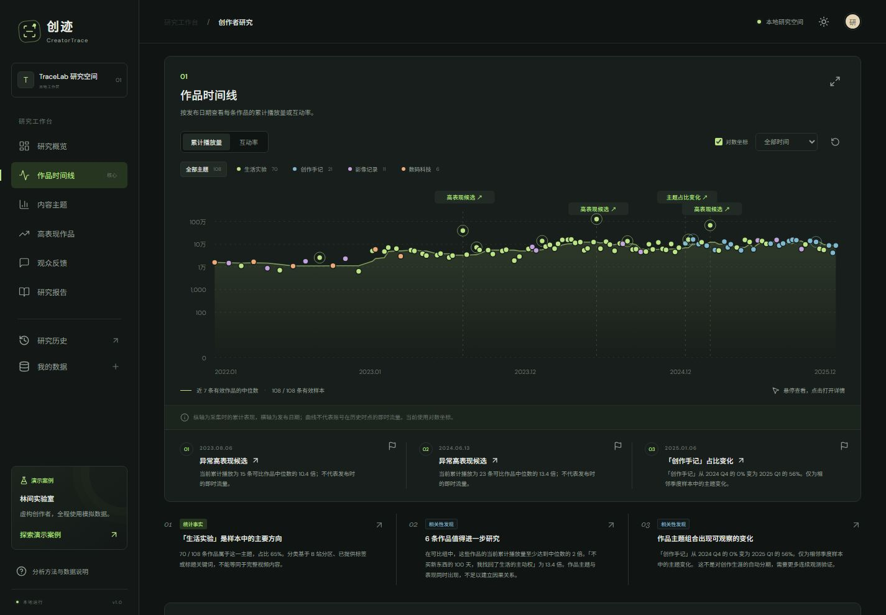

# TraceLab · 创迹 CreatorTrace

一个 Bilibili 创作者研究工具，由本地 Dashboard 和 Chrome 插件组成。它通过作品、主题、当前累计表现和采样评论，回答一个问题：**一个创作者如何一步步形成自己的内容方向？**



## 快速开始

需要 **Node.js 22.13+** 和 npm（开发环境为 Windows / Node 24.15.0）。

```bash
npm ci
npm run dev
```

打开 <http://localhost:5173>，默认进入模拟案例“林间实验室”，不需要配置 `.env`。

粘贴 B 站主页链接或 UID，点击“分析创作轨迹”，就能用公开接口研究真实创作者。如果遇到 HTTP 412，请看[公开接口的访问限制](#公开接口的访问限制)。

生产运行：

```bash
npm run build
npm start
```

打开 <http://localhost:3001>。同一个进程同时提供 API 和 Dashboard。

> 服务默认只监听本机，没有多用户隔离。不要把 API 直接暴露到公网。

## 功能

- **创作者画像**：昵称、简介、粉丝数、作品数量、发布时间范围、近期播放中位数和发布频率。缺失的数据显示“暂无数据”，不会补造。
- **交互式时间线**：切换播放量 / 互动率和对数 / 线性坐标，按主题和时间筛选，支持键盘操作、作品详情和自定义标记。
- **内容主题**：主题分布、各主题播放中位数、季度占比变化和代表作品，并标明每条作品的分类来源。
- **高表现作品**：用可比作品计算相对表现，而不是只排总播放，可以查看对照作品和基准值。
- **观众反馈**：按规则归组评论并展示原文；配置 LLM 后支持聚类和情绪标签。公开接口不采集评论正文，这部分只在导入数据或网关提供评论时可用。
- **五章研究报告**：创作者概览、创作轨迹、关键转折、内容特点、分析结论。区分事实、相关性和待验证的解释，引用可点击。
- **研究档案**：报告保存在本地 SQLite，可查看历史，可导出 Markdown / JSON，也可通过浏览器打印为 PDF。

## 数据来源

| 来源 | 适用场景 | 需要准备 | 说明 |
| --- | --- | --- | --- |
| 模拟案例 | 了解产品 | 无 | 虚构创作者，108 条作品、12 条评论，全程标记为模拟 |
| 文件导入 | 使用自己的数据 | CSV / JSON | 数据由你提供，系统不证明其真实性 |
| 网站公开接口（默认） | 研究任意 UID | 无 | 实验性，非官方授权，可能被限制，默认最多 30 条作品 |
| 官方 OAuth 网关 | 分析自己授权的账号 | 开放平台应用凭证 | 只能读取授权账号，不能研究任意 UID |

任何来源失败时都会明确报错，不会用模拟数据冒充真实结果。

## 网站公开接口

服务端依次匿名读取创作者资料、作品列表和视频详情，不读取 Cookie，不模拟登录，不做 WBI 签名，也不使用代理。详细规则见[公开接口读取说明](docs/public-data.md)。

| 项目 | 行为 |
| --- | --- |
| 采集范围 | 默认最多 30 条，不是完整历史 |
| 请求节奏 | 串行，间隔 1 秒，单次采集预算约 80 秒 |
| 归属校验 | 详情的 `owner.mid` 与 UID 不符的作品会被排除，并报告数量 |
| 缓存 | 同一 UID 的结果在当前进程内缓存 10 分钟，保留原采集时间 |
| 部分失败 | 第一页读取失败时研究失败；之后失败则保留已取得的真实字段并附警告 |

可设置 `PUBLIC_DATA_ENABLED=false` 关闭此来源。

### 公开接口的访问限制

`/x/series/recArchivesByKeywords` 可能返回 HTTP 412，这是 B 站的访问限制，不是程序错误，无法靠修改代码根除。B 站没有公开规则，少量请求也可能被拦。

遇到限制时，程序会立即停止采集并冷却 1 分钟，不会自动重试，也不会更换接口或身份。冷却结束后需要手动重试，但这不代表限制已解除。

建议这样处理：

1. 不要反复重试。连续碰到 2～3 次后，隔 10 分钟以上再试。
2. 不要靠重启服务绕过冷却。冷却状态只保存在内存里，重启会清空，但 B 站的限制还在。
3. 在研究历史中查看已保存的报告，或改用文件导入。

## 主题如何分类

每条作品的主题按下面的优先级确定，并记录来源：

| 优先级 | 来源 | 标记 | 说明 |
| --- | --- | --- | --- |
| 1 | LLM 分类 | `llm` | 手动触发，覆盖最近 120 条作品 |
| 2 | 导入数据提供的主题 | `provided` | 来自 CSV / JSON 的 `topic` |
| 2 | B 站分区 | `platform` | 公开接口按 `tid` 查[分区映射表](packages/core/src/bilibili-zones.ts) |
| 3 | 关键词规则 | `rule` | 只覆盖 4 个主题，匹配不上的归为“其他内容” |

使用时注意：

- 分区是投稿时选择的，不等于内容主题。主要投一个分区的创作者，主题图可能只有一种颜色，想看细分方向可以运行 AI 分类。
- 映射表依据社区文档整理，不是官方数据。未收录的 `tid` 不做猜测，会回退到关键词规则并在警告中注明数量。

## Chrome 插件

```bash
npm run build
```

1. 打开 `chrome://extensions`，开启开发者模式。
2. 点击“加载已解压的扩展程序”，选择 `dist/extension` 目录。代码更新并重新构建后，要在此页面重新加载。
3. 打开 `https://space.bilibili.com/<UID>`，点击扩展图标。
4. 点击“分析创作轨迹”，Dashboard 会在新标签页打开并带入主页链接。

插件默认连接 `http://127.0.0.1:5173`；使用 `npm start` 时，请在 Popup 中改为 `http://127.0.0.1:3001`。

插件只申请 `activeTab`、`scripting` 和 `storage` 权限，不读取 Cookie，不在后台采集，也没有全站访问权限。在 Dashboard 点击分析后才会联网。

## 导入数据

支持 UTF-8 编码的 CSV / JSON，文件不超过 4 MB，最多 2,000 条作品和 2,000 条评论。

- [CSV 模板](examples/import-template.csv)：必填 `id,title,publishedAt,collectedAt`。
- [完整 JSON 示例](examples/demo-dataset.json)：包含创作者、作品、评论、来源和警告。
- [演示报告](examples/demo-report.md)：导出后的报告样例。

CSV 可选列：`description,tags,views,likes,coins,favorites,comments,shares,duration,format,topic,cover,url,source`。

- `tags` 用 `|` 分隔，`duration` 单位为秒，`format` 取 `video`、`short`、`live` 或 `unknown`。
- 数值缺失时留空，不能写成“1.2万”。
- 时间建议写成 `2025-01-10T10:00:00+08:00`。CSV 只写日期时按北京时间零点解释；JSON 必须带时间和时区。
- 缺少 `duration` 或 `format` 时不计算相对表现。

导出的报告 JSON 可以重新导入，系统会用其中的数据重新计算。模拟数据重新导入后仍保留模拟标记。

## 配置

复制 `.env.example` 为 `.env` 后按需填写，修改后重启服务。**所有配置都是可选的。**

| 变量 | 作用 |
| --- | --- |
| `PORT`、`HOST` | API 端口和监听地址，默认 `3001`、`127.0.0.1` |
| `PUBLIC_DATA_ENABLED` | 设为 `false` 时关闭公开接口 |
| `AI_API_KEY`、`AI_MODEL`、`AI_BASE_URL` | LLM 配置 |
| `AI_TIMEOUT_MS` | 单次模型请求的总时限，默认 `900000`（15 分钟） |
| `LIVE_*`、`BILIBILI_*` | 授权网关配置，建议用 `npm run setup:live` 生成 |

### AI 深度解读

模型需要兼容 OpenAI Chat Completions，并支持流式输出和 `response_format: json_schema`。配置后，在报告中点击“生成 AI 深度解读”才会调用。

分析在后台运行，页面会显示进度。带思考过程的模型可能较慢，比如 `kimi-k3.1-pro` 分类 28 条作品实测约 4 分钟。

调用时，作品标题、简介、标签、统计和采样评论会发送到你配置的服务。

AI 先做分类和评论聚类，再由代码重新计算指标，最后根据新统计撰写报告。如果引用无效、输出被截断或请求失败，会保留基础报告。

### 官方授权网关

```bash
npm run setup:live
# 在 .env 填写 BILIBILI_CLIENT_ID 和 BILIBILI_CLIENT_SECRET，并核对回调地址
npm run dev
```

然后在 Dashboard 依次点击“连接 B 站”、“前往 B 站授权”、“分析已授权账号”。完整步骤见[官方授权网关接入](docs/live-gateway.md)，外部数据服务的协议见[数据访问与网关契约](docs/data-access.md)。

## 分析方法与解读边界

- **播放量是累计值**：所有播放量都是采集时的累计数字，不是发布时的流量，也不能还原历史粉丝增长。
- **相对表现**：当前播放量除以可比作品的播放中位数。可比作品须满足：内容形式相同、发布相距不超过 120 天、采集相距不超过 7 天、发布时长比 0.67–1.5、视频长度比 0.5–2、都已发布至少 30 天，且至少有 5 条。达到 2 倍才算高表现候选。
- **主题变化**：相邻季度各有至少 5 条作品，且某主题占比上升至少 40 个百分点时才标记。这只是启发式规则，不代表统计显著，也不能断定是创作转折。
- **不做因果判断**：主题与表现同时出现不等于因果关系；评论是非随机样本，不代表全体观众。

详见[分析方法](docs/methodology.md)。

## 当前验证状态

截至 2026-11-09：

| 能力 | 状态 |
| --- | --- |
| 模拟案例、文件导入、统计分析、报告导出 | 自动化测试通过 |
| 公开接口 | 已用真实数据生成报告，主题分区已在真实采集中生效；可用性时好时坏，不保证任意账号都能读取 |
| Chrome 插件 | 构建、Manifest、识别和跳转已通过自动化测试（模拟 Chrome API）；尚未在日常 Chrome 中完成真实安装验收 |
| LLM 分析 | 只用模拟响应测试过流程，未用真实模型调用，语义质量未验证 |
| 官方 OAuth 网关 | 只用模拟上游测试过本机链路；因没有开放平台凭证，未与 B 站真实联调 |
| 打印 / PDF | 已实现打印布局，未逐页检查导出的 PDF |

验收记录见[验收说明](docs/qa.md)。

## 开发

```bash
npm run dev        # 启动 API（3001）和 Web（5173），API 改动后自动重启
npm run check      # TypeScript 类型检查
npm run lint       # ESLint
npm test           # 运行测试
npm run build      # 构建 Dashboard 和 Chrome 插件
npm run verify     # 依次运行 lint、测试和构建
```

自动化测试不访问 B 站或真实 LLM，因此不能证明线上接口可用。下面两条命令会真实联网，受限后请勿循环运行：

```bash
npm run probe:bilibili                    # 只读探测接口，每个端点请求一次
npx tsx scripts/check-public-live.ts <UID>  # 真实采集诊断，结果不保存
```

### 目录结构

```text
apps/
  web/        React Dashboard
  api/        Express API、公开接口采集、LLM、SQLite 存储
  gateway/    官方 OAuth 数据网关
  extension/  Chrome MV3 插件
packages/core/src/
              数据模型、统计分析、导入、报告、分区映射表
tests/        自动化测试
examples/     可导入的样例和演示报告
docs/         设计与验收文档
```

本地数据在 `.data/tracelab.sqlite`，密钥在 `.env`，都已被 `.gitignore` 排除。构建产物在 `dist/`。

### 文档

- [技术架构与数据模型](docs/architecture.md)
- [分析方法](docs/methodology.md)
- [公开接口读取说明](docs/public-data.md)
- [官方授权网关接入](docs/live-gateway.md)
- [数据访问与网关契约](docs/data-access.md)
- [验收说明](docs/qa.md)

## 暂不支持

其他平台接入、长期监控和历史快照、字幕 / 弹幕 / 视频画面理解、多用户与公网分享、创作者对比。
