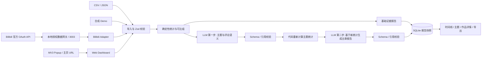

# TraceLab / 创迹 CreatorTrace 架构

## 产品问题

一个创作者如何逐渐形成自己的内容方向？用作品列表、当前累计表现和采样评论寻找可核对的线索，而不是声称还原不存在的历史流量或粉丝快照。

## 技术决策

采用 npm workspaces 管理 TypeScript Monorepo。Web 为 React 19 + Vite；API 为 Express 5；验证使用 Zod；数据保存在 Node 内置 SQLite；插件为原生 Manifest V3 + TypeScript，esbuild 构建。

相对推荐栈的调整：

- 本地研究工具没有 SEO 或服务端渲染需求，因此使用 Vite + Express，开发时代理 API、生产时同一个进程提供静态页面与 API。
- 原生 SVG 让每个时间线点直接支持键盘焦点、悬停、点击和标记，无需额外图表运行时。主题分布用 CSS 环图，季度占比用可点击的堆叠条。
- 插件只负责读取当前页与打开 Dashboard，不需要 WXT 的后台生命周期设施；不申请全站权限或 cookies 权限。
- SQLite 通过 Repository (`ReportStore`) 隔离。MVP 仅保存 JSON 报告快照和索引字段，后续可替换为 Prisma / PostgreSQL。没有让 ORM 成为本地运行前置条件。
- npm 随 Node 提供，单一锁文件方便用 `npm ci` 复现环境。各 workspace 依赖统一提升到根目录。

## 数据流



## 目录

```text
apps/
  web/src/
    App.tsx              页面与异步操作协调
    Timeline.tsx         时间线、筛选、悬停、键盘和标记
    Topics.tsx           主题分布、比较和季度变化
    ResearchPanels.tsx   高表现作品、评论、报告与详情
    ui.tsx               通用 UI、格式化与 API 客户端
    styles.css           深浅色、响应式与打印布局
  api/
    app.ts               路由、校验、任务、错误与来源控制
    providers.ts         标准 Provider 和 Bilibili 授权网关 Adapter
    ai.ts                两步结构化 LLM 分析与证据校验
    store.ts             SQLite Repository
    index.ts             进程入口
  gateway/
    official.ts          官方签名 / OAuth / 串行请求 / 限流停止
    service.ts           浏览器绑定授权 / 续期 / 分页 / 统计 / 缓存
    vault.ts             AES-GCM 加密令牌存储
    app.ts               本机 Bearer 认证与网关路由
  extension/             Popup、Manifest、只读页面识别
packages/core/src/
  model.ts               Zod schema、类型和 Bilibili URL 解析
  demo.ts                固定随机种子合成数据
  import.ts              CSV parser 和 JSON 导入
  analysis.ts            统计、相对表现、关键词分类和节点候选
  report.ts              五章规则报告与 Markdown 导出
tests/                   统计、API、AI、插件、Provider 测试
examples/                可直接导入的 CSV / JSON 样例
docs/                    架构、数据访问、方法和演示说明
```

## 数据模型

所有字段经服务端 Zod 校验；不信任浏览器或模型返回值。

| 模型 | 核心字段 |
| --- | --- |
| Creator | id、platform、name、bio、avatar、url、followers |
| Video | id、title、description、tags、publishedAt、collectedAt、views、likes、coins、favorites、comments、shares、duration、format、topic、topicSource、cover、url、source |
| Comment | id、videoId、text、likes、collectedAt、source |
| Dataset | version、mode、creator、videos、comments、collectedAt、source、coverage、totalVideos、warnings |
| Report | id、createdAt、dataset、analysis、ai、aiModel |

数值与外部链接缺失时使用 `null`。每条视频保留独立的采集时间和来源，评论保留作品引用。CSV 日期若不含时间，按北京时间零点解释并在警告中说明。标准 JSON 时间必须是带时区的 ISO 8601。负数、非整数计数、重复视频 ID、错误日期、评论悬空引用、非 HTTP(S) 链接拒绝导入。

## API

| Method | URL | 作用 |
| --- | --- | --- |
| GET | `/api/health` | 返回配置状态；不返回密钥；配置不代表已验证 |
| GET | `/api/demo` | 开箱即用的完整模拟报告 |
| POST | `/api/import` | `{format: "csv" | "json", content: string, creatorName?: string}` |
| POST | `/api/research` | `{url: string}` 或官方 `{account: "self"}`；未配置返回 503，已配置时创建采集任务 |
| GET | `/api/jobs/:id` | 真实任务状态与进度 |
| GET | `/api/reports/:id` | 读取持久化报告；`demo` 为默认案例 |
| POST | `/api/reports/:id/ai` | 显式触发两步 LLM；失败保留原报告 |
| GET | `/api/history` | 最近 30 份本机研究 |
| GET | `/api/template.csv` | CSV 模板下载 |
| GET | `/api/template.json` | 完整模拟 JSON 数据集下载 |

Live 任务为内存任务，服务重启后需重新提交；完成的报告持久化到 SQLite。最多同时 2 个 Live 任务、2 个 AI 任务，同一报告不能并行重复调用 AI。非运行任务一小时后在提交新任务时清理。内置 Demo 是缓存的确定性报告；真实采集不缓存授权失效结果。

## 本地安全与运行边界

- 默认绑定 `127.0.0.1`，不提供多用户鉴权，不适合直接暴露到公网。
- API 限制 Host 与浏览器 Origin。外部网站不能向本机写入研究数据。
- 参数化 SQLite 查询；导入最大 4 MB / 2,000 条作品；请求体最大 5 MB。
- 模型 Key、网关 Key 只来自服务端环境变量，前端只得到布尔配置状态。
- 模型输入将标题、描述和评论视为不可信数据；不提供工具调用；响应严格校验。
- 插件仅使用 `activeTab`、`scripting`、`storage`，由用户点击后读取当前页，不读取 Cookie。
- 不实现多平台真实 Adapter、长期监控、跨创作者排名或多模态分析。

## 官方网关

完整实现与运行方式见 [官方授权网关接入](live-gateway.md)。应用使用 `LIVE_DATA_URL` 调用独立的本机 3003 服务；也可使用外部已授权网关。内置网关绑定一个 OAuth 账号，OpenID 不映射为 UID；数据源配置、授权有效与采集成功分别显示。应用 API 不向前端返回密钥或 Token。
