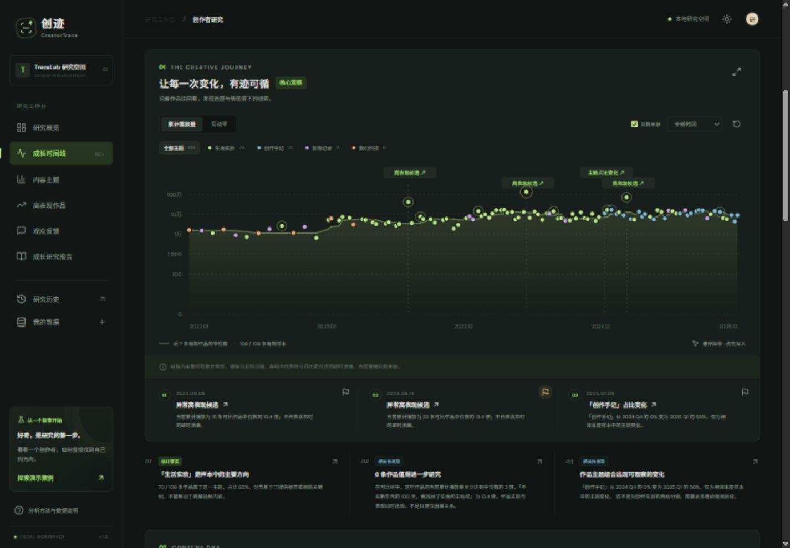
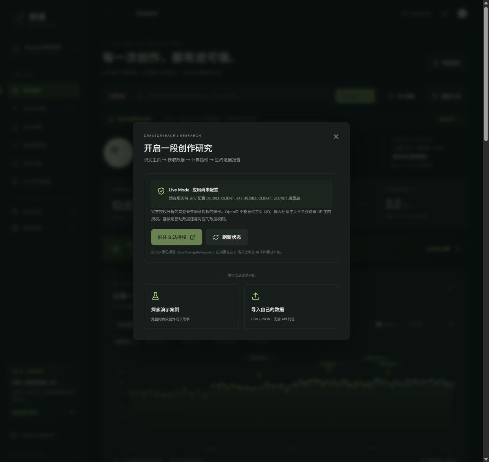
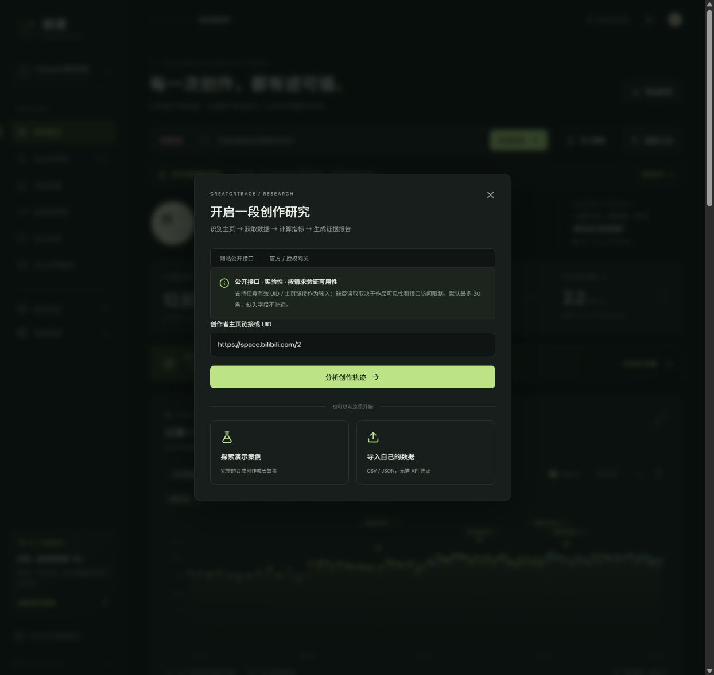

# 验收记录

验证日期：2026-11-09（北京时间）。环境：Windows、Node 24.15.0、npm 11.12.1。

## 自动化结果

`npm run verify` 通过：ESLint → 测试 → TypeScript → Vite → MV3 构建。

**39 tests / 39 passed / 0 failed / 0 skipped**（包含 API 集成用例的 8 个子测试）。

| 测试文件 | 覆盖内容 |
| --- | --- |
| `core.test.ts` | URL 与恶意相似域名、时区与日期、重复 ID、评论引用、缺失/零/极端值、中位数、互动率、可比组排除自身、时间/时长/形式匹配、最小样本、季度缺口、Demo 可复现、CSV 引号/BOM/换行、JSON 回读、报告证据 |
| `ai.test.ts` | JSON Schema、五章完整性、虚构引用、重复分类、密钥缺失、两步统计口径一致、HTTP 429 后保留基础报告、报告不包含密钥 |
| `api.test.ts` | 实际本机 HTTP 请求：健康、Demo、CSV 导入、SQLite 回读、历史、错误请求、未配置 Live/AI、Origin 拒绝、SQL 形状参数、模板 |
| `extension.test.ts` | Manifest V3 权限范围、打包 Popup 在模拟 Chrome API 下自动识别 UID / 名称、手动 UID、Dashboard 与 Demo 跳转 |
| `provider.test.ts` | 模拟授权网关能力校验、统一模型、采集阶段、评论失败降级；无授权声明时绝不发请求 |

构建产物：

- `dist/web/`：生产 Web，JS 约 349 KB（gzip 约 104 KB），CSS 约 52 KB（gzip 约 11 KB）。
- `dist/extension/`：可加载的 MV3 扩展。
- `dist/CreatorTrace-extension.zip`：扩展打包档案，加载时解压后选择目录。

## 浏览器实际验收

使用应用内 Chromium 浏览器连接本机 Vite 页面，实际执行并检查状态：

| 流程 | 结果 |
| --- | --- |
| 默认 Demo | 明确模拟标识，108 条作品、12 条合成评论，完整五章报告 |
| 时间线指标切换 | 累计播放 / 互动率切换后图形及有效样本数更新 |
| 主题筛选 | 生活实验过滤为对应样本，重置后恢复全部 108 条 |
| 键盘探索 / Tooltip | 聚焦数据点显示标题、作品示意封面、日期、播放与点赞 |
| 异常作品详情 | 查看 `demo-053`，约 13.4 倍相对表现、23 条对照、9.6 万基准，评论和来源可读 |
| 标记 | 点击后变为“取消时间线标记”，图中显示标记环 |
| Live 未配置 | 真实 UID 2 被识别；明确显示未配置授权源，不替换为该 UP 主的假数据 |
| CSV 导入 | 通过系统文件选择器导入样例并命名；得到 2 条作品；缺失粉丝为暂无数据；仅 1 / 2 条可算互动率；无高表现候选 |
| 历史与刷新恢复 | 刷新 URL 后仍恢复导入报告；历史可见该研究 |
| JSON 导入 | 完整合成数据 JSON 重新导入后仍为 Demo，不改成真实数据 |
| LLM 未配置 | 显示服务端配置说明，不假装 AI 已运行 |
| 深浅主题 | 两个模式切换并检查 `data-theme` 状态 |
| 移动端 | 390 × 844 尺寸测试菜单、导航和指标；页面没有横向溢出，时间线在自身容器横向滚动 |
| 桌面端 | 1440 × 1000 尺寸无横向溢出，时间线、节点和证据卡完整可见 |
| Markdown 导出 | 真实下载完成；读取落盘文件，确认模拟标识、`demo-053` 引用和方法局限 |
| JSON 导出 | 真实下载完成；解析落盘文件，确认 mode=demo 且含 108 条原始作品 |
| 浏览器日志 | 最后一轮查询未发现 warning/error |

下载测试曾遇到一次自动化工具超时，恢复后重新完成并检查了落盘文件，未把超时尝试算作成功。

移动端原先把全宽 SVG 缩得太小；验收中修正为仅图表横向滑动，确认内容宽度 816 px、容器 345 px，同时整页不溢出。



## 生产启动

为避免占用开发 API 端口，临时以 PORT=3002 运行 `npm start`，实际 HTTP 检查：

- `/` 返回 200，包含 TraceLab 页面。
- `/api/health` 返回 ok=true。
- `/api/demo` 返回 mode=demo、108 条作品。

临时生产验证服务检查后关闭；日常 `npm start` 不设置 PORT 时使用 3001。

## 仍需手工 / 凭证验收

1. **真实 Chrome 加载**：本次没有安装进用户的日常 Chrome 配置。依照 README 加载 `dist/extension`，分别在 B 站主页和非 B 站页面验证 Popup、DOM 资料降级、手动输入和新标签跳转。自动化测试模拟 Chrome API，不能替代这一步。
2. **真实 LLM**：没有真实 Key。Mock 证明的是请求协议、两步流程、校验与恢复，不是特定模型的可用性或叙事质量。配置可用模型后核对引用、数字、分类和推断语气。
3. **Live**：已新增官方 OAuth 网关并验证本机 HTTP 链路。当前没有开放平台应用凭证，仍需按 docs/live-gateway.md 完成真实授权、数据核对、续期和撤权联调。匿名列表遇到 -799 / HTTP 412 后未绕过限制。
4. **打印 / PDF**：已实现打印布局和 `window.print()`，未保存并逐页检查浏览器打印的 PDF。可在 Chrome 导出对话框中检查分页后保存。
5. **运行范围**：没有验证公网部署、多用户访问、长期采集或其他操作系统的 Chrome DOM 差异。

## 可复现检查清单

```bash
npm ci
npm run verify
npm run dev
```

按 README 的五分钟路线操作；重点看每个结论是否能回溯到作品、数据不足时是否诚实降级，以及模拟/导入/Live/AI 标识是否保持一致。

## 官方 Live 网关追加验收（2026-11-09）

- 最终 `npm run verify`：**54 / 54 测试通过**；ESLint、TypeScript、Web 生产构建与 MV3 插件构建通过。
- `gateway.test.ts` 新增 15 项测试：官方签名 2.0、OAuth POST 参数、绝对到期时间、state 与浏览器绑定及防重放、无凭证状态、分页去重与无效行、空样本、统计权限不足、缓存及并发、单次续期、撤权清理、采集中断、AES-GCM 文件持久化及保存失败、真实本机 HTTP 报告链路。
- HTTP 链路中仅 B 站上游被模拟；实际运行应用 API、网关路由、OAuth Cookie 回调、Adapter、统计及 SQLite。不会用这个测试宣称真实 B 站接口联调完成。
- 本机当前 `/api/health` 实测：`liveConfigured=true`、`reachable=true`、`state=app_unconfigured`、`authorized=false`、`liveVerified=false`，没有泄漏 Client Secret / Token / 网关密钥。
- 实际浏览器：桌面与 390 × 844 窄屏检查“连接 B 站”、未配置原因、禁用授权按钮、刷新状态、失败反馈和 Demo 保持可用；恢复默认视口。
- 内置官方连接界面仅展示“分析已授权账号”；不会让用户填写 UID 后得到别人的 OAuth 数据。外部网关保留 URL 采集表单。
- 当前运行开发服务：Dashboard 5173、API 3001、官方网关 3003；未配置 Client ID / Client Secret，未发起真实授权。

最初在沙箱运行时，本机 HTTP 被 EACCES 拒绝、临时目录重命名被 EPERM 拒绝；获准运行本机集成测试后通过。真实外部联调仍需要应用凭证，详见 [官方网关接入](live-gateway.md)。



## 网站公开接口追加验收（2026-11-09）

- 新增 9 项公开数据测试，最终 **63 / 63 通过**，Lint、类型检查、Web 与 MV3 构建通过。
- 本机 HTTP 测试覆盖 source=public → 采集 → 分析 → 报告存储，上游使用模拟响应。
- 插件自动化测试核对 UID / 主页解析与 source=public 跳转参数。
- 浏览器实测插件等价 URL 带入 UID 2、默认公开来源、切换官方网关及切回公开来源，输入保留，按钮可用。未再次提交真实请求。
- 真实网络：资料、29 条列表记录和部分详情曾成功返回；修正 owner 过滤后的复测返回 HTTP 412，停止。没有完整真实报告成功记录，不能宣称任意 UP 主可稳定采集。
- 具体范围与限制：[公开接口读取](public-data.md)。


